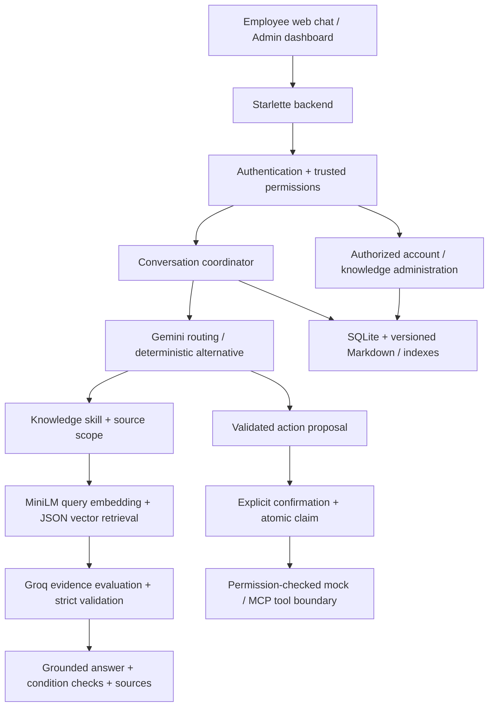

# Knowvia — Evidence-Aware Enterprise AI Agent

Knowvia is an evidence-aware enterprise AI agent that answers employee questions
from company documents and prepares IT support actions behind explicit confirmation.
It demonstrates AI and software engineering through grounded retrieval, secure
Python backend services, persistent workflows and controlled tool integration.

**[Public HTTPS demonstration](https://desktop-md6j59m.taild8d8ea.ts.net/)**
· **[Technical documentation](docs/README.md)**
· **[Source repository](https://github.com/Marghaleryrasooly/knowvia-agent)**

The demonstration uses fictional **NovaTech** policies and administrator-provisioned
accounts. It runs on a Windows host through Tailscale Funnel; availability depends
on that computer and its services remaining online. This is an engineering portfolio
project with a demonstration environment, not a production-certified enterprise service.

## Overview

Employees need dependable answers to internal questions, not plausible policy guesses.
Actions require a stronger boundary still: a language model must not decide who has
permission or execute a newly proposed ticket without approval.

Knowvia combines semantic retrieval with an explicit evidence-sufficiency decision,
validated supporting sources, trusted identity resolution and confirmation-gated tools.
Its employee chat and separate admin dashboard make these boundaries testable end to end.

### Main objectives

- Answer only when accessible company evidence establishes the requested information.
- Keep routing suggestions separate from deterministic authorization and execution.
- Preserve conditions, source attribution and uncertainty in generated responses.
- Support persistent employee conversations and controlled knowledge administration.
- Compare model behavior through fixed acceptance scenarios and regression tests.

## Key features

| Area | Implemented capabilities |
| --- | --- |
| Employee assistant | Company Q&A, supporting sources, safe abstention, bounded follow-ups and clarification |
| Actions | IT ticket proposals, explicit confirmation/cancellation, mock ticket status and notifications |
| Identity and access | Argon2id passwords, server-side sessions, trusted roles and permission-scoped knowledge |
| Administration | Account provisioning, activation/deactivation, role assignment and sanitized activity |
| Knowledge management | Markdown staging, explicit source access, validated publication, version history and rollback |
| Interface | Vanilla web chat, persistent Recent conversations, safe answer formatting and separate admin UI |
| Deployment | HTTPS demonstration, trusted hosts, Secure cookies, mock-only public actions and persistent local storage |

## Engineering highlights

- **Retrieval is not proof:** related chunks do not automatically authorize an answer.
- **Fail-closed evidence handling:** invalid or insufficient decisions do not proceed
  to grounded answer generation; semantic repair remains bounded.
- **Conditional answers:** policy reporting is distinct from personal eligibility.
  Unknown eligibility cannot be presented as verified.
- **Source discipline:** selected supporting IDs are validated against retrieved
  candidates; citations are constructed from those selected records, not invented URLs.
- **Execution authority:** an action request creates a proposal, not permission to
  execute it. Confirmation is bound to authoritative pending state, identity and session.
- **Request ownership:** in-flight responses remain attached to their originating
  conversation when the user navigates or performs unrelated sidebar operations.
- **Safe knowledge updates:** publication validates a separately built index before
  atomically selecting it; previous published versions remain available for rollback.

These safeguards reduce risk, but model judgments and generated language still require
evaluation. They are not a mathematical guarantee against every unsupported response.

## Technology stack

| Component | Implementation |
| --- | --- |
| Backend | Python 3.11+, Starlette/ASGI, Uvicorn |
| Frontend | Vanilla HTML, CSS and JavaScript |
| Routing | Gemini model-assisted routing in the public demo; deterministic router for local/offline use |
| Evidence and answers | Groq `openai/gpt-oss-120b` by default |
| Local inference alternative | Explicitly selected Ollama / Llama 3.2 |
| Additional inference adapter | Optional Gemini evidence/generation provider, separate from routing |
| Embeddings | Sentence Transformers `all-MiniLM-L6-v2`; optional pinned FP32 ONNX provider |
| Retrieval | Section-based Markdown chunks, JSON vector index and cosine similarity |
| Persistence | SQLite accounts, sessions, authority, conversations, proposals and ticket state; local knowledge versions |
| Tool integration | Permission-filtered tool schemas, confirmation gate and MCP integration boundary |
| Public hosting | Windows-hosted service through Tailscale Funnel HTTPS |

## System architecture



### How the agent works

1. Authenticate the employee and resolve current trusted permissions.
2. Resolve only bounded, identity/session-owned conversation context.
3. Route to knowledge, an action proposal or clarification.
4. For knowledge, retrieve within the selected skill and permitted source scope.
5. Evaluate answerability, validate supporting IDs and preserve applicable conditions.
6. Generate from validated support, or abstain without inventing missing company rules.
7. For actions, wait for explicit confirmation of a pre-existing authoritative proposal.
8. Persist transcript and action state for subsequent server-authoritative history restoration.

Supporting sources, confirmation cards and terminal action states remain associated
with their original conversation turns.

## Evidence-aware RAG

The bundled fictional corpus covers HR, IT, finance and general company knowledge.
Documents are split by section and embedded into the existing vector index.
Runtime queries use the same model identity as the stored vectors.

The evidence contract distinguishes **GENERAL**, **POLICY_REPORTING** and
**PERSONAL_ELIGIBILITY** answer scopes. Reporting a documented conditional rule
does not prove that the current employee qualifies. Procedure questions require
actual procedure evidence; an approval requirement alone is not a submission workflow.

Structured-output parsing, source selection and condition preservation are checked
before an answer is accepted. Equivalent condition paraphrases can pass a bounded
semantic check; omitted, reversed, weakened, invented or uncertain conditions fail closed.
No insufficient decision is automatically promoted to sufficient.

Examples supported by the current fictional corpus include VPN troubleshooting,
lost-device reporting and the conditional annual-leave allowance. Forgotten-password
recovery and a vacation-request submission procedure are not documented and should abstain.

## Authentication, authorization and security

- Passwords are hashed with Argon2id; plaintext passwords are not stored.
- Sessions are server-side; the database stores token digests rather than bearer tokens.
- Accounts, directory status and current role permissions are rechecked on requests.
- Administrators cannot be created through public self-promotion.
- Admin mutations require server-side authorization and same-origin JSON requests.
- Deactivation revokes sessions; the last active administrator is protected.
- Knowledge access is scoped by trusted permissions and explicit document access.
- Pending proposals use one-time atomic claims; repeated confirmation cannot execute twice.
- Public HTTPS uses Secure/HttpOnly session cookies, trusted hosts and security headers.
- User text is escaped; assistant formatting is a bounded Markdown subset with no active HTML or links.
- Public self-registration and real Jira mutations are disabled in the Funnel profile.

API keys stay server-side in ignored configuration. Test passwords and fictional
employee identifiers are not safe public credentials. No default admin password exists.

## Admin dashboard and knowledge management

The separate `/admin` interface reuses the same authentication system.
Authorized administrators can provision accounts, manage active status and assign
roles from the existing permission catalog. Activity views expose bounded, sanitized
administrative events, not unrestricted employee transcripts or session secrets.

Markdown documents can be staged, replaced or removed with explicit skill/access
assignments. Upload validation prevents unsafe names and paths. Publication builds
and validates a new index before changing the authoritative active version.
Draft conflicts and failed publication cannot silently replace the working corpus.
Rollback selects a previous published version; runtime data persists across restarts.

See [admin authority](docs/administration.md) and
[knowledge management](docs/admin-knowledge-management.md) for operational details.

## Installation and configuration

### Prerequisites

- Python 3.11 or newer.
- Server-side Groq and Gemini API access for the public-demo configuration.
- Network access for hosted inference and the initial local embedding-model download.
- A persistent writable data directory. Tailscale is needed only for Funnel hosting.

### Install

```powershell
git clone https://github.com/Marghaleryrasooly/knowvia-agent.git
cd knowvia-agent
python -m venv .venv
.venv\Scripts\python.exe -m pip install -e ".[dev,gemini]"
Copy-Item .env.example .env
```

Copy the template only for a fresh checkout; never overwrite existing private settings.
The bundled `data/knowvia_index.json` is included—normal startup does not require rebuilding it.

Set credentials privately in the ignored `.env`. These names are configuration,
not credential values:

| Setting | Purpose |
| --- | --- |
| `GROQ_API_KEY` | Default evidence and answer inference |
| `GEMINI_API_KEY` | Model-assisted routing |
| `KNOWVIA_AGENT_ROUTER=gemini` | Public-demo routing selection |
| `KNOWVIA_GENERATION_PROVIDER=groq` | Explicit default answer provider |
| `KNOWVIA_EVIDENCE_EVALUATOR=groq` | Explicit default evidence provider |
| `KNOWVIA_DATA_DIR` | Persistent private runtime storage |
| `KNOWVIA_AGENT_TOOL=mock` | Safe fictional ticket actions |
| `KNOWVIA_ENABLE_REAL_JIRA_MUTATIONS=false` | Keep external Jira mutations disabled |

The default inference model is `openai/gpt-oss-120b`.
Evidence uses temperature 0.0, medium reasoning and a 2,048-token completion cap;
answers use temperature 0.1, low reasoning and a 1,024-token cap.
Evidence-evaluation and grounded-answer inference do not automatically retry
transport failures or switch providers. Gemini routing has separate, bounded
resilience behavior; it does not bypass authorization or evidence validation.

## Running locally

For localhost HTTP, set `KNOWVIA_ENVIRONMENT=development` and
`KNOWVIA_AUTH_COOKIE_SECURE=false` in private local configuration.
Keep browser identity overrides disabled for authenticated demonstrations.

```powershell
.venv\Scripts\python.exe -m knowvia.web
```

Open `http://127.0.0.1:8000`. For a fresh data directory, privately bootstrap
the first administrator, then provision employee accounts through `/admin`:

```powershell
.venv\Scripts\python.exe -m knowvia.admin --employee-id demo-admin --email admin@novatech.example --first-name Demo --last-name Administrator
```

The one-time bootstrap prompts for a password using hidden terminal input.
Use the same data directory as the web service. Do not run bootstrap against an
existing installation merely to test it.

For optional Ollama inference, set both provider selectors to `ollama`, install
Ollama separately and make the configured `llama3.2:latest` model available.
Gemini routing remains independent. Optional ONNX setup is described in the
[technical documentation index](docs/README.md).

## Live demonstration and deployment

The [public HTTPS demonstration](https://desktop-md6j59m.taild8d8ea.ts.net/) uses
administrator-provisioned fictional accounts. Contact the project owner for demo access;
credentials are not published in this repository.

The Funnel launcher selects Groq and Gemini, trusted hosts, secure cookies,
mock tools and disabled public registration. It preserves local databases and
knowledge files and does not itself activate Funnel.
Follow the [deployment checklist](docs/tailscale-demo.md) rather than exposing
an arbitrary local process or copying database files into the repository.

The laptop must remain awake, connected and running the service.
Docker and production entry points also exist, but the current public demo is not
a stateless serverless deployment. Any alternative host must preserve accounts,
sessions, uploaded documents, indexes and publication history on durable storage.

## Testing and evaluation

The [evaluation catalog](evaluation/README.md) maps all versioned datasets to
their purposes and runners, with historical filenames preserved for reproducibility.

The deterministic suite covers evidence contracts, permission boundaries,
authentication, admin operations, knowledge publication/rollback, conversation
ownership, action confirmation, provider transport and frontend injection protection.

```powershell
.venv\Scripts\python.exe -B -m pytest -q -m "not live and not ollama_live and not m3_live and not m4_live and not m5_live and not gemini_live and not jira_live"
.venv\Scripts\python.exe -B -m knowvia.repository_safety
```

The last application verification reported **901 passed, 1 skipped and 3 live tests
deselected**. This is a recorded result, not a promise about every environment.

### Historical model comparison

The fixed acceptance matrix contains **57 turns across 41 scenarios**:

| Recorded metric | Earlier local Llama reference | Completed Groq evaluation |
| --- | --- | --- |
| Strict passes | 36/57 (63.2%) | 55/57 (96.5%) |
| Expected abstentions | 8/10 | 10/10 |
| Unsafe answers observed | 1 | 0 |
| Supporting-source precision | 47.9% | 100% |

These are results on a small project-specific matrix, **not universal model accuracy**.
The runs occurred at different implementation stages; they are system-level reference
comparisons, not an isolated model-only experiment. Strict grading also includes wording
and source checks. Saved private reports remain outside Git.

A subsequent condition-validation correction passed **four targeted live checks**:
authorized IT/VPN, unsupported account access, conditional policy reporting and unknown
personal eligibility. The full 57-turn benchmark was **not rerun after that correction**.
See [evaluation methodology](evaluation/LOCAL_ACCEPTANCE.md).

## Current limitations

- Model-based evidence and condition judgments can still vary or incorrectly abstain.
- The knowledge corpus is intentionally small and fictional; undocumented policy is not invented.
- Demonstration actions are mock IT tickets, not a live Jira deployment.
- SQLite/local files assume one process/replica and durable storage, not distributed scaling.
- Password reset, email verification, MFA and enterprise SSO/OIDC are not implemented.
- Registration identity matching is not email-ownership verification; public registration stays disabled.
- Hosted inference depends on provider availability, free-tier quotas and network access.
- Funnel availability depends on the host laptop; there is no high-availability hosting guarantee.
- This project has not undergone an independent enterprise security audit.

## Technical documentation

- [Documentation index](docs/README.md)
- [Administrator authority and account operations](docs/administration.md)
- [Knowledge-document management](docs/admin-knowledge-management.md)
- [HTTPS demonstration operations](docs/tailscale-demo.md)
- [Acceptance evaluation and safe runner usage](evaluation/LOCAL_ACCEPTANCE.md)
- [Development history and detailed reference material](docs/development-history.md)
- [Fictional company corpus](knowvia_m1_dataset/README.md)

Historical internal milestone identifiers are retained only in the development-history
reference. Current behavior is defined by the implemented code and current documentation.
